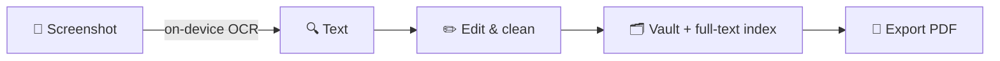

<div align="center">

# Deskvanic

**Your Mac. One workspace.**

15 native macOS tools in one app — connected by real cross-tool workflows.

[](LICENSE)
[]()
[]()
[]()
[](../../actions)

[English](README.md) · [中文](README.zh-CN.md)


</div>

---

Most Mac productivity tools do **one** thing. You end up with a launcher here, a clipboard manager there, a screenshot app, a PDF tool, an automation app — none of them talk to each other.

**Deskvanic puts 15 tools in one native app, and connects them.** Screenshot → OCR → archive → PDF. Batch-resize → compress → beam to your phone. A receipt photo becomes a structured record with a due-date reminder. Not by scripting glue — the workflow engine calls the *real* implementations of each tool, with type-checked inputs and outputs.

- **Native & fast** — Swift 6 / SwiftUI / AppKit, strict concurrency throughout
- **Zero third-party dependencies** — every line is Apple frameworks or hand-written. Even ZIP is implemented from scratch (CRC-verified, bomb-proofed, traversal-guarded)
- **Local-first** — no account, no telemetry, no cloud. OCR and speech run on-device first
- **Free & open** — MIT, forever

## ✨ What no competitor has

### 1. Workflows across tools that actually share data



Raycast automates *extensions*. Keyboard Maestro automates *the system*. Deskvanic's Flow Engine orchestrates **its own built-in tools** through a typed data protocol — a `Trim` node's PDF output plugs into a `Zip` node, which plugs into `SaveToVault`, with the graph validator rejecting mismatches before anything runs.

### 2. Privacy that is *verified*, not just claimed

- Strip GPS/EXIF → **re-inspects the written file** and deletes the output if location data survived ([test](Tests/DeskvanicModuleTests/ZIPTests.swift))
- Redaction blur is **true pixel destruction**, never an overlay layer
- Local transfer server uses **constant-time token comparison**, RFC 5987 filename encoding, streamed downloads
- When on-device speech isn't available for a language, the UI **says so** — no silent cloud fallback
- Adversarial tests live in the suite: path traversal, symlink escape, zip bombs, SQL/FTS injection, CRC tampering

### 3. A supply chain of exactly zero

`Package.swift` has no dependencies. The entire attack surface for `swift package resolve` is Apple. In 2026's dependency-compromised world, that's a feature.

### 4. CJK-first, not CJK-ported

Chinese-aware clipboard cleanup (hard-wrap repair), CJK character-level FTS tokenization, Chinese/English OCR in one pass, fully bilingual UI. Most competitors are English-first with Chinese as an afterthought.

## 🧰 The 15 tools

| | Tool | What it does |
|---|---|---|
| ⌘ | **Command Center** | ⌃⇧Z global palette — apps, commands, files, vault; fuzzy search; favorites |
| 📋 | **ClipVault** | Text/URL/image/file history, dedup, pinning, plain-text paste, templates |
| 📸 | **Capture** | Region/window/full screenshots, on-device OCR, QR decode, annotations, pixel-true redaction, pin-to-desktop |
| 🗂 | **File Studio** | Image convert/resize/compress, PDF merge/split/rotate/extract, hand-rolled ZIP, batch rename, processing templates |
| 🔍 | **Recall Vault** | Text/link/image/PDF archive, tags, full-text search, copy-vs-reference storage, backup |
| ✂️ | **Quick Tools** | Text cleanup/replace/case, diff, Markdown preview, QR, color, calculator (+ Decimal money mode), units, timer, pomodoro |
| 🧹 | **Clean Manager** | Big files, exact duplicates (full SHA-256), similar images (aHash), rule-based folder organizing — preview → confirm → trash-recoverable |
| 📡 | **NearLink** | LAN transfer to phone browsers via QR + expiring token (honestly labeled: not TLS) |
| 🪟 | **SessionDock** | Save window layouts, launch app sets, restore positions via AX API |
| 🎙 | **VoiceDock** | Dictation (on-device first), audio-file transcription, user dictionary, insert-into-app |
| 📖 | **GuideCraft** | Step-by-step tutorial capture with auto-numbering, sensitive-info scan, MD/HTML/PDF export |
| 🧾 | **PaperTrail** | Receipt/contract OCR pre-fill (marked *unverified* until you confirm), due-date reminders |
| 🌐 | **Web Vault** | URL collection, metadata & article extraction, dedup by normalized URL, reading list |
| 🎬 | **Media Studio** | A/V trimming, audio extraction, WAV/AIFF/M4A transcode, GIF generation, waveform |
| ⚙️ | **Flow Engine** | Typed node pipelines over the real tools: validation, dry-run, timeout, retry, cancel, folder-watch triggers |

## 🔗 Six real end-to-end workflows (tested, not promised)

Every one of these runs as an automated test against real files, real Vision OCR, and real sockets:

1. **Screenshot research** — capture → OCR → clean → vault → FTS hit → PDF export
2. **Batch & send** — 3 photos → pipeline resize → compress to target → NearLink transfer, byte-identical on receive
3. **Download folder triage** — scan → plan → move with conflict report → re-run guard → audit trail
4. **Voice note** — record → (transcribe) → clean → vault → clipboard
5. **Receipt filing** — photo → OCR amount/date → human confirm → due-date list → full-text search
6. **Tutorial build** — step shots → privacy scan → standalone HTML + PDF

## ⚡ Quick start

**Build from source** (recommended — no Gatekeeper dance):

```bash
git clone https://github.com/ClearJan/Deskvanic.git
cd Deskvanic
scripts/build-app.sh      # Release 构建 → 组装 .app → ad-hoc 签名
open build/Deskvanic.app
```

**Or grab a release**: download the `.dmg`, drag to Applications. First launch: **right-click → Open** (ad-hoc signature, see [docs/KNOWN_ISSUES.md](docs/KNOWN_ISSUES.md)).

Requirements: macOS 14+, Apple Silicon, Xcode 16+ (Swift 6) toolchain.

## 🆚 How it compares

| | Deskvanic | Raycast | Alfred | CleanShot X | Paste | Hazel | Keyboard Maestro |
|---|---|---|---|---|---|---|---|
| Launcher | ✅ | ✅ | ✅ | — | — | — | — |
| Clipboard manager | ✅ | extension | ✅ | — | ✅ | — | — |
| Screenshot + OCR | ✅ | paid ext | — | ✅ | — | — | — |
| File/PDF/ZIP batch | ✅ | — | — | — | — | ✅ | — |
| Knowledge vault + FTS | ✅ | — | — | — | — | — | — |
| Visual tool pipelines | ✅ | scripts | snippets | — | — | ✅ | ✅ |
| LAN transfer | ✅ | — | — | — | — | — | — |
| Open source | ✅ MIT | ❌ | ❌ | ❌ | ❌ | ❌ | ❌ |
| Price | free | subscription | paid | paid | paid | paid | paid |

*Each competitor is excellent at its own domain — this table is about coverage and licensing, not quality.*

## 🔒 Security & engineering

- **215 automated tests**, including the six end-to-end workflows above, zip/system `zip` interop, and adversarial input suites
- **Independent audit**: full read-only audit was run over the codebase; all 21 findings (1×P1, 9×P2, 11×P3) are fixed with regression tests — see [docs/SECURITY_AUDIT.md](docs/SECURITY_AUDIT.md) and [docs/ENGINEERING_LOG.md](docs/ENGINEERING_LOG.md)
- **Database**: SQLite + WAL, 12-version migration chain with rollback tests, `VACUUM INTO` backup
- **Honesty policy**: capabilities and limits are documented as-is — [docs/KNOWN_ISSUES.md](docs/KNOWN_ISSUES.md) lists every known limitation

## 🗺 Roadmap

- [ ] Canvas-style flow editor (engine already supports arbitrary DAGs)
- [ ] ScreenCaptureKit migration for capture
- [ ] Safari share extension for Web Vault
- [ ] Optional TLS mode for NearLink
- [ ] Full English String Catalog localization

## 🤝 Contributing

PRs welcome — run `swift test` first (must be green). Architecture overview: [docs/ARCHITECTURE.md](docs/ARCHITECTURE.md).

## 📄 License

[MIT](LICENSE) — use it, fork it, ship it.
