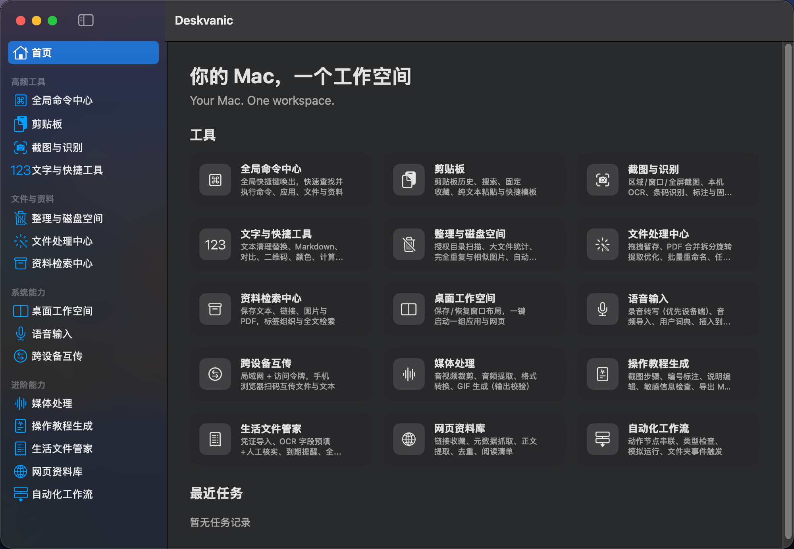
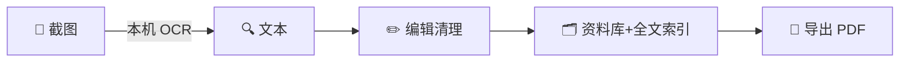

<div align="center">

# Deskvanic

**Your Mac. One workspace.**

15 个原生 macOS 工具 · 一个应用 · 真实的跨工具工作流

[](LICENSE)
[]()
[]()
[]()
[](../../actions)

[English](README.md) · [中文](README.zh-CN.md)



</div>

---

大多数 Mac 效率工具只做**一件事**。你最终装了一堆：一个启动器、一个剪贴板工具、一个截图工具、一个 PDF 工具、一个自动化工具——它们互不相通。

**Deskvanic 把 15 个工具装进一个原生应用，并且把它们连起来。** 截图 → OCR → 归档 → 导出 PDF；批量缩放 → 压缩 → 隔空发给手机；一张发票照片变成带到期提醒的结构化记录。不靠脚本胶水——工作流引擎调用的是每个工具的**真实实现**，输入输出经过类型检查。

- **原生 & 快** — Swift 6 / SwiftUI / AppKit，全程严格并发检查
- **零第三方依赖** — 每一行都是系统框架或手写实现。连 ZIP 都是从零实现（CRC 校验、炸弹防护、穿越防护）
- **本地优先** — 无账号、无遥测、无云。OCR 与语音优先在本机运行
- **免费开源** — MIT，永久

## ✨ 竞品没有的东西

### 1. 工具之间真正共享数据的工作流



Raycast 自动化的是**扩展**，Keyboard Maestro 自动化的是**系统**。Deskvanic 的 Flow Engine 编排的是**内置工具本身**——通过带类型的数据协议，`PDF 拆分` 节点的输出直接接入 `ZIP 打包` 节点，再接入 `存入资料库`，图校验器会在运行前拒绝任何类型错配。

### 2. 经过*验证*的隐私，而不是口头承诺

- 抹除 GPS/EXIF 后会**重新检查写出的文件**，位置信息若残留则自动删除输出（有对应测试）
- 打码是**真像素破坏**，绝不是覆盖一层图层
- 本地传输服务器使用**常量时间令牌比较**、RFC 5987 文件名编码、流式下载
- 某语言不支持设备端语音识别时，界面**如实标注**——绝不静默走云端
- 测试套件里有对抗性用例：路径穿越、符号链接逃逸、ZIP 炸弹、SQL/FTS 注入、CRC 篡改

### 3. 供应链为零

`Package.swift` 没有任何依赖项。整个攻击面就是 Apple。在依赖投毒频发的年代，这本身就是功能。

### 4. CJK 优先，而不是"顺手支持中文"

中文感知的剪贴板清理（硬换行修复）、CJK 逐字 FTS 分词、中英文一次 OCR、完整中英双语界面。

## 🧰 15 个工具

| | 工具 | 功能 |
|---|---|---|
| ⌘ | **全局命令中心** | ⌃⇧Z 全局面板——应用/命令/文件/资料，模糊搜索，收藏 |
| 📋 | **剪贴板** | 文本/链接/图片/文件历史、去重、固定、纯文本粘贴、模板 |
| 📸 | **截图** | 区域/窗口/全屏，本机 OCR，二维码识别，标注，真像素打码，桌面钉图 |
| 🗂 | **文件处理** | 图片转换/缩放/压缩，PDF 合并/拆分/旋转/提取，手写 ZIP，批量重命名，处理模板 |
| 🔍 | **资料库** | 文本/链接/图片/PDF 收藏，标签，全文检索，复制 vs 引用双模式，备份 |
| ✂️ | **快捷工具** | 文本清理/替换/大小写、对比、Markdown 预览、二维码、颜色、计算器（含 Decimal 金额模式）、单位、计时器、番茄钟 |
| 🧹 | **磁盘整理** | 大文件、完全重复（全量 SHA-256）、相似图片（感知哈希）、规则整理——预览→确认→可恢复 |
| 📡 | **互传** | 扫码 + 限时令牌，手机浏览器与 Mac 互传（如实标注：非 TLS） |
| 🪟 | **工作空间** | 保存窗口布局，一键启动应用组并恢复位置 |
| 🎙 | **语音输入** | 听写（设备端优先）、音频转写、用户词典、插入其他应用 |
| 📖 | **教程生成** | 步骤截图自动编号、敏感信息扫描、导出 MD/HTML/PDF |
| 🧾 | **票据管家** | 发票/合同 OCR 预填（标记"待核实"由你确认）、到期提醒 |
| 🌐 | **网页资料库** | 链接收藏、正文提取、规范化去重、阅读清单 |
| 🎬 | **媒体处理** | 音视频裁剪、提取音频、WAV/AIFF/M4A 转码、GIF、波形 |
| ⚙️ | **工作流引擎** | 类型化节点流水线：校验、模拟运行、超时、重试、取消、文件夹监听触发 |

## 🔗 六条真实的端到端工作流（有测试，不是口号）

以下每一条都是自动化测试，走真实文件、真实 Vision OCR、真实网络套接字：

1. **截图研究** — 截图 → OCR → 清理 → 资料库 → 全文命中 → 导出 PDF
2. **批量与发送** — 3 张图 → 流水线缩放 → 压缩达标 → NearLink 传输逐字节一致
3. **下载目录整理** — 扫描 → 计划 → 带冲突报告移动 → 重跑防护 → 审计留痕
4. **语音笔记** — 录音 → 转写 → 清理 → 资料库 → 剪贴板
5. **票据归档** — 拍照 → OCR 金额/日期 → 人工确认 → 到期列表 → 全文检索
6. **教程制作** — 步骤截图 → 隐私扫描 → 独立 HTML + PDF

## ⚡ 快速开始

**源码构建**（推荐，无 Gatekeeper 问题）：

```bash
git clone https://github.com/ClearJan/Deskvanic.git
cd Deskvanic
scripts/build-app.sh      # Release 构建 → 组装 .app → ad-hoc 签名
open build/Deskvanic.app
```

**或下载 Release**：下载 `.dmg` 拖入「应用程序」。首次打开：**右键 → 打开**（ad-hoc 签名，详见 [docs/KNOWN_ISSUES.md](docs/KNOWN_ISSUES.md)）。

要求：macOS 14+，Apple Silicon，Xcode 16+（Swift 6）工具链。

## 🆚 横向对比

| | Deskvanic | Raycast | Alfred | CleanShot X | Paste | Hazel | Keyboard Maestro |
|---|---|---|---|---|---|---|---|
| 启动器 | ✅ | ✅ | ✅ | — | — | — | — |
| 剪贴板 | ✅ | 扩展 | ✅ | — | ✅ | — | — |
| 截图 + OCR | ✅ | 付费扩展 | — | ✅ | — | — | — |
| 文件/PDF/ZIP 批处理 | ✅ | — | — | — | — | ✅ | — |
| 资料库 + 全文检索 | ✅ | — | — | — | — | — | — |
| 可视化工具流水线 | ✅ | 脚本 | 片段 | — | — | ✅ | ✅ |
| 局域网互传 | ✅ | — | — | — | — | — | — |
| 开源 | ✅ MIT | ❌ | ❌ | ❌ | ❌ | ❌ | ❌ |
| 价格 | 免费 | 订阅 | 付费 | 付费 | 付费 | 付费 | 付费 |

*每个竞品在自己的领域都很优秀——本表只比较覆盖面与许可，不比较质量。*

## 🔒 安全与工程

- **215 项自动化测试**，含上述六条端到端工作流、与系统 zip 的互操作、对抗性输入套件
- **独立审计**：全代码库只读审计，21 项发现（1×P1、9×P2、11×P3）全部修复并有回归测试——见 [docs/SECURITY_AUDIT.md](docs/SECURITY_AUDIT.md) 与 [docs/ENGINEERING_LOG.md](docs/ENGINEERING_LOG.md)
- **数据库**：SQLite + WAL，12 版迁移链带回滚测试，`VACUUM INTO` 备份
- **诚实原则**：能力与限制如实记录——[docs/KNOWN_ISSUES.md](docs/KNOWN_ISSUES.md) 列出全部已知限制

## 🗺 路线图

- [ ] 画布式工作流编辑器（引擎已支持任意 DAG）
- [ ] 截图迁移到 ScreenCaptureKit
- [ ] Web Vault 的 Safari 共享扩展
- [ ] NearLink 可选 TLS 模式
- [ ] 完整英文 String Catalog 本地化

## 🤝 参与贡献

欢迎 PR——请先跑 `swift test`（必须全绿）。架构总览：[docs/ARCHITECTURE.md](docs/ARCHITECTURE.md)。

## 📄 许可证

[MIT](LICENSE) — 随意使用、fork、分发。
